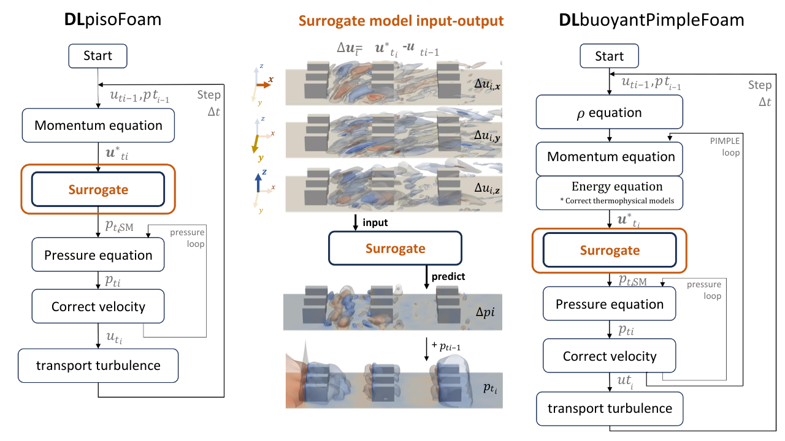
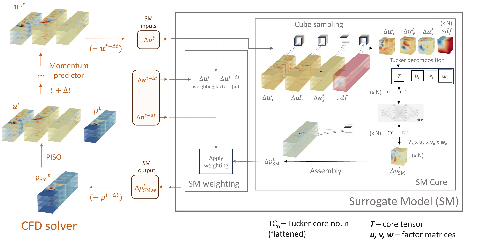

# DLpisoFoam, DLpimpleFoam_auto, DLbuoyantPimpleFoam & DLbuoyantPimpleFoam_auto

**Deep Learning-Enhanced CFD Solvers for Accelerated Fluid Flow Simulations**

<p align="center">
  
</p>

## 📋 Contents

- [Introduction](#-introduction)
- [Surrogate Model Overview](#surrogate-model-overview)
- [What This Repository Enables](#-what-this-repository-enables)
- [Key Features](#-key-features)
- [Publications](#-publications)
- [Repository Structure](#-repository-structure)
- [Getting Started](#-getting-started)
  - [Prerequisites](#prerequisites)
  - [Part 1: Environment Setup](#part-1-environment-setup)
    - [Option 1: Docker (Recommended)](#option-1-docker-recommended)
    - [Option 2: Local Installation](#option-2-local-installation)
  - [Part 2: Preparing Datasets & Training Your Surrogate Model](#part-2-preparing-datasets--training-your-surrogate-model)
    - [Part 2.1: Generate CFD Training Data](#part-21-generate-cfd-training-data)
    - [Part 2.2: Train the Surrogate Model](#part-22-train-the-surrogate-model)
  - [Part 3: Running Your First CFD Simulation with the Surrogate Model](#part-3--running-your-first-cfd-simulation-with-the-surrogate-model)
    - [Part 3.1: Run the DLpisoFoam Test Case with the PRE-TRAINED Surrogate Model](#part-31-run-the-dlpisofoam-test-case-with-the-pre-trained-surrogate-model)
    - [Part 3.2: Run DLpisoFoam with YOUR trained Surrogate model](#part-32-run-dlpisofoam-with-your-trained-surrogate-model)
- [AUTO Workflow: Sampling, Training and Simulation](#auto-workflow-sampling-training-and-simulation)
- [Available CFD Solvers](#-available-cfd-solvers)
  - [DLpisoFoam](#dlpisofoam)
  - [DLpimpleFoam_auto](#dlpimplefoam_auto)
  - [DLpimpleFoam_oracle](#dlpimplefoam_oracle)
  - [DLbuoyantPimpleFoam](#dlbuoyantpimplefoam)
  - [DLbuoyantPimpleFoam_auto](#dlbuoyantpimplefoam_auto)
- [Legacy Solvers](#-legacy-solvers)
- [Citation](#-citation)
- [Contact](#-contact)
- [Acknowledgments](#acknowledgments)

## 🎯 Introduction

This repository contains **machine learning-enhanced OpenFOAM solvers** that accelerate computational fluid dynamics (CFD) simulations using deep learning estimates of pressure and pressure-velocity corrections.

**DLpisoFoam**, **DLpimpleFoam_auto**, **DLbuoyantPimpleFoam**, and **DLbuoyantPimpleFoam_auto** are based on OpenFOAM v8 and implement the PISO/PIMPLE algorithms with integrated neural network surrogate models for improved pressure-velocity coupling. The AUTO workflows can train their own surrogate model during the simulation, requiring no pre-trained model or offline dataset generation.

This is an **all-in-one repository** containing both surrogate models and CFD solvers, building upon the work from [Solving-Poisson's-Equation-through-DL-for-CFD-applications](https://github.com/pauloacs/Solving-Poisson-s-Equation-through-DL-for-CFD-apllications).


### Two Training Workflows

- **Offline training and deployment:** generate datasets, train a surrogate, then run a CFD case with its model artifacts. The existing guide below covers this workflow.
- **AUTO training:** run CFD to collect samples, train an initial surrogate, and activate it in the same simulation. See the [AUTO quick start](#auto-workflow-sampling-training-and-simulation) for the new isothermal PIMPLE examples.

---

## Surrogate Model overview

<p align="center">
  
</p>

---

## 🎯 What This Repository Enables

This repository provides a complete workflow for accelerating CFD simulations with machine learning:
1. **Generate Training Data**: Run CFD simulations to create comprehensive datasets from various flow scenarios (examples in `gen_datasets/`)
2. **Train Surrogate Models**: Develop neural network models that learn to predict pressure corrections in unsteady CFD simulations (examples in `train_SM/`)
3. **Deploy in Production**: Integrate trained models with custom OpenFOAM-based solvers for accelerated simulations (examples in `tutorials/`)

Alternatively, **sample, train and simulate in one AUTO run** using `DLpimpleFoam_auto` or the thermal AUTO workflow. In the new PIMPLE integration, learned estimates initialize pressure and optionally velocity; conventional CFD correction and convergence checks remain in place.

---

## ✨ Key Features

- 🚀 **Accelerated simulations**: Up to 40% less iterations required to convergence when compared to standard OpenFOAM solvers
- 🧠 **ML-powered**: Machine Learning surrogate models enhance pressure Poisson solver
- 🌡️ **Multiple physics**: Supports isothermal and thermal flows
- 🔧 **OpenFOAM compatible**: Drop-in replacement for `pisoFoam` and `buoyantPimpleFoam`
- 🤖 **Self-training**: `DLbuoyantPimpleFoam_auto` trains its surrogate model automatically during the simulation — no pre-trained model needed
- **Isothermal AUTO PIMPLE**: `DLpimpleFoam_auto` supports gridded CNN shifters and mesh-graph shifters, with pressure-only or supported joint pressure/velocity prediction
- **Controlled oracle comparisons**: `DLpimpleFoam_oracle` compares conventional CFD with idealized reference-field injection to study the attainable integration benefit
- 🐳 **Docker ready**: Pre-built containers for easy deployment
- 📊 **2D & 3D**: Surrogate models available for both 2D and 3D simulation cases

---

## 📚 Publications

### 1. Surrogate Model Development
**Application of machine learning to model the pressure Poisson equation for fluid flow on generic geometries**  
[Neural Computing and Applications (2024)](https://link.springer.com/article/10.1007/s00521-024-09935-0)
- Detailed description of the ML surrogate model architecture and training

### 2. DLpisoFoam Benchmark
**Enhancing CFD solver with Machine Learning techniques**  
[Computer Methods in Applied Mechanics and Engineering (2024)](https://www.sciencedirect.com/science/article/pii/S004578252400389X)
- Performance benchmarks and validation of DLpisoFoam solver

### 3. Improved Pressure-Velocity Coupling
[SSRN Preprint (2025)](https://papers.ssrn.com/sol3/papers.cfm?abstract_id=5364744)
- Enhanced pressure surrogate model and integration methodology

### 4. 3D Extensions *(Coming Soon)*
- Extension to 3D surrogate models and complex geometries

---

## 📁 Repository Structure

```
DLpisoFoam/
├── source/                        # Solver source code
│   ├── DLpisoFoam/                 # Incompressible isothermal solver
│   ├── DLbuoyantPimpleFoam/        # Thermal flow solver
│   ├── DLbuoyantPimpleFoam_auto_delta_delta/ # Thermal AUTO variant
│   ├── DLpimpleFoam_auto/         # Self-training isothermal PIMPLE solver
│   └── DLpimpleFoam_oracle/       # Reference-field integration diagnostic
├── pressure_SM/             # Surrogate models
│   ├── 2D/                   # 2D models
│   │   ├── train_and_eval/    # Training & evaluation scripts
│   │   └── CFD_usable/        # Interface for integration with CFD solver
│   └── 3D/                   # 3D models
│       ├── train_and_eval/    # Training & evaluation scripts
│   │   └── CFD_usable/        # Interface for integration with CFD solver
├── pressure_SM_gridded_shift/ # Gridded CNN shifter framework
├── pressure_SM_mesh_graph/    # Mesh-graph shifter framework
├── tutorials/                # Offline, AUTO and oracle example cases
│   ├── DLpimpleFoam_auto/
│   │   ├── gridded_shift/    # Pressure-only lattice shifter example
│   │   └── graph_shift/      # Pressure-only and joint graph examples
│   └── DLpimpleFoam_oracle/  # Pressure-only and joint oracle examples
├── gen_datasets/             # Dataset generation scripts
├── other_solvers/            # Legacy solver versions
├── Dockerfile                # Docker build configuration
└── env_311.yml               # Python environment specification
```

---


## 🚀 Getting Started

This guide will walk you through:
1. Setting up your environment (Docker or local)
2. Training a surrogate model (SM) from scratch
3. Running CFD simulations with the trained model

For the self-training isothermal solver, complete environment setup and then skip the offline dataset/model preparation steps by following the [AUTO quick start](#auto-workflow-sampling-training-and-simulation).

---

### Prerequisites

- **For Docker**: Docker installed ([Get Docker](https://docs.docker.com/get-docker/))
- **For local install**: 
  - OpenFOAM v8
  - Conda or Miniconda
  - Python 3.11

---

## Part 1: Environment Setup

### Option 1: Docker (Recommended)

**Easiest method with automated setup and guaranteed reproducibility.**

#### Pull pre-built image:
```bash
docker pull pauloacs/dlpisofoam:latest
```

#### Or build locally:
```bash
docker build -t dlpisofoam .
```

#### Run container:
```bash
docker run -it -v $(pwd):/home/repo --rm pauloacs/dlpisofoam bash
```

This mounts your current directory inside the container at `/home/repo`.

---

### Option 2: Local Installation

#### Step 1: Create Python environment
```bash
conda env create -f env_311.yml
conda activate python311_solver
```

#### Step 2: Install surrogate model packages
```bash
python -m pip install -e .
```

#### Step 3: Set up OpenFOAM environment
```bash
source /opt/openfoam8/etc/bashrc  # Adjust path to your OpenFOAM installation
source prep_env311.sh             # Set Python/NumPy paths in the current shell
```

**Note**: You may need to modify `prep_env311.sh` with paths to your conda environment:
```bash
export PYTHON_INCLUDE_PATH=$CONDA_PREFIX/include/python3.11
export NUMPY_INCLUDE_PATH=$CONDA_PREFIX/lib/python3.11/site-packages/numpy/core/include
export PYTHON_LIB_PATH=$CONDA_PREFIX/lib
export PYTHON_LIB_NAME=lpython3.11
```

#### Step 4: Compile the solvers

**For DLpisoFoam:**
```bash
cd source/DLpisoFoam
wclean
wmake
```

**For DLbuoyantPimpleFoam:**
```bash
cd source/DLbuoyantPimpleFoam
wclean
wmake
```

Verify installations:
```bash
which DLpisoFoam
DLpisoFoam -help
```

```bash
which DLbuoyantPimpleFoam
DLbuoyantPimpleFoam -help
```

---

## Part 2: Preparing Datasets & Training Your Surrogate Model

### Part 2.1: Generate CFD Training Data

Use the scripts in `gen_datasets/` to generate training datasets from various flow scenarios:

- **Confined flows over chip arrays**: Electronics cooling simulations
- **Flow around squared cylinders**: Bluff body aerodynamics
- **Flow over inclined plates**: Boundary layer studies

All configurations support both **isothermal** and **thermal** conditions to match your application requirements.

Modified versions of `pisoFoam` and `buoyantPimpleFoam` are included to extract the necessary flow field data for training. Depending on the simulation type, generation can be fully or semi-automatic.

---

### Part 2.2: Train the Surrogate Model

Navigate to `train_SM/` and use the `run_train.sh` scripts to train your model:

```bash
cd train_SM/
# Edit run_train.sh to set your datasetPath
./run_train.sh
```

**Key Configuration:**
- **Required**: Set `datasetPath` to your training dataset location
- **Optional**: Adjust hyperparameters (learning rate, batch size, dropout, etc.)

**Training Outputs:**
- **Model file**: HDF5 format TensorFlow model (e.g., `model_MLP_small-std-drop0.1-lr0.0005-regNone-batch1024.h5`)
- **Compression artifacts**: Tucker factors (3D cases) or PCA vectors (2D cases) (required for CFD deployment)

These files are ready to use with the CFD solvers - the model weights/biases load automatically via TensorFlow.

---

## Part 3: 🏃 Running Your First CFD Simulation with the Surrogate Model

### Part 3.1: Run the DLpisoFoam Test Case with the PRE-TRAINED Surrogate Model

```bash
# Navigate to test case
cd tutorials/DLpisoFoam/

# Run mesh generation (if needed)
./genMesh.sh

# Run the solver
DLpisoFoam
```

```bash
# Open in ParaView
paraFoam

# Or use built-in post-processing
postProcess -func 'mag(U)'
```

---

### Part 3.2: Run DLpisoFoam with YOUR trained Surrogate model

1. **Copy the example test case:**
  ```bash
  cp -r tutorials/DLpisoFoam/array_of_cyks tutorials/DLpisoFoam/my_custom_test
  cd tutorials/DLpisoFoam/my_custom_test
  ```

2. **Copy your trained surrogate model files:**
  ```bash
  # Copy your TensorFlow model
  cp /path/to/your/model.h5 .
  
  # Copy compression artifacts (Tucker factors (3D cases) or PCA vectors (2D cases))
  cp /path/to/your/tucker_factors.pkl .
  
  # Copy normalization files
  cp /path/to/maxs .
  cp /path/to/mean_std.npz .
  ```

---


## AUTO Workflow: Sampling, Training and Simulation

`DLpimpleFoam_auto` starts with conventional CFD, writes selected training fields to HDF5, runs initial model training, and activates the surrogate without restarting the simulation. It can also reuse compatible trained artifacts with `train=False`.

### Build and Run

From the repository root, after activating the Python environment and sourcing OpenFOAM:

```bash
source prep_env311.sh
python -m pip install -e '.[mesh_graph]' mpi4py
wmake source/DLpimpleFoam_auto
wmake source/DLpimpleFoam_oracle

cd tutorials/DLpimpleFoam_auto/graph_shift/pressure_only
bash Allrun
```

Use the project's scientific Python environment from `env_311.yml`; the gridded framework also needs its pandas, SciPy, scikit-learn, numba, matplotlib and tensorly dependencies. Embedded Python and the training subprocess must use the same compatible environment. Build from the current sources; older container images may not contain the latest AUTO modes. The executable remains `DLpimpleFoam_auto` for both frameworks and prediction modes.

### Frameworks and Examples

| Framework | Python Package | Compact Examples |
| --- | --- | --- |
| Gridded shifter | `pressure_SM_gridded_shift` | [Pressure-only CNN](tutorials/DLpimpleFoam_auto/gridded_shift/pressure_only) |
| Graph shifter | `pressure_SM_mesh_graph` | [Pressure-only](tutorials/DLpimpleFoam_auto/graph_shift/pressure_only), [joint pressure/velocity](tutorials/DLpimpleFoam_auto/graph_shift/joint) |

The gridded example transfers fields to one whole-domain regular lattice. The graph framework uses native CFD cell connectivity and face-connected aggregates instead of a lattice. Joint velocity prediction is currently demonstrated by the graph framework, not the gridded shifter.

Both support pressure increment/residual targets (`dp` or `ddp`) when configured consistently. The joint graph model can predict `dU` or `ddU`; it returns the total reconstructed velocity increment for the solver to apply once. Boundary conditions, flux updates and normal PIMPLE correction remain part of the CFD solver.

### Case Controls

- **`python_module.py`:** framework selection (`training_backend='lattice'` or `'mesh_graph'`), selected inputs, model size, target variables, training settings, output weights, and `train=True/False`.
- **`system/MLSamplingDict`:** warm-up, sampling cadence, initial training threshold, prediction integration, velocity extrapolation, and optional fixed-pressure reconstruction before normal PIMPLE.
- **`system/fvSolution`:** linear solvers, equation relaxation, and normal PIMPLE convergence controls. Oracle-compatible integration also uses its momentum equation relaxation for reconstruction.

`train=False` requires the case's matching model, normalization and geometry artifacts; it does not create a missing model. Changing the input set, target, graph coarsening or architecture requires compatible samples and retraining.

The current graph AUTO workflow supports **initial training only**; incremental graph updates are not implemented, and the examples disable resampling after activation. This differs from the retraining-capable gridded/thermal workflows. Run the compact graph examples **serially**, not with `mpirun`.

### Outputs and Interpretation

`Allrun` builds and checks the small example mesh before running the solver. Logs show sampling, training, surrogate activation, reconstruction, PIMPLE work and step timings. Generated models, normalization files and training diagnostics are placed in `ML_data/`. Use `bash Allclean` before a fresh tutorial run; it deletes generated outputs and trained artifacts while retaining initial fields.

The compact examples contain only small text inputs and train from scratch. They demonstrate integration, not mesh-independent accuracy or a guaranteed speedup. Evaluate total timestep cost, pressure iterations, outer iterations and physical errors at matched settings. The oracle uses reference information unavailable to a deployed model, so its results are an idealized diagnostic baseline, not an achieved ML performance claim.

See the [tutorial guide](tutorials/README.md) for detailed commands, mode switches, loss options, prerequisites and cleanup behavior, and the [oracle examples](tutorials/DLpimpleFoam_oracle) for pressure-only and joint reference-injection comparisons.

---


## 🔧 Available CFD Solvers

### DLpisoFoam
**For incompressible, isothermal flows**

- Based on OpenFOAM's `pisoFoam`
- Uses pressure surrogate model to accelerate PISO algorithm
- Ideal for: laminar/turbulent flows, external aerodynamics, internal flows

**Example applications:**
- Flow over cylinders
- Channel flows

---

### DLpimpleFoam_auto
**For incompressible, isothermal flows with self-training PIMPLE acceleration**

- Collects selected CFD fields, trains an initial surrogate, and activates it during the same run
- Supports the `pressure_SM_gridded_shift` lattice framework and `pressure_SM_mesh_graph` graph framework
- Predicts pressure increments/corrections; the graph backend also supports joint velocity increments/corrections
- Applies learned estimates as initial guesses, with optional reconstruction and normal CFD convergence checks
- Can reuse compatible saved models with `train=False`; initial graph training does not require pretrained weights

**Start here:** [AUTO quick start](#auto-workflow-sampling-training-and-simulation) and [compact tutorials](tutorials/DLpimpleFoam_auto).

---

### DLpimpleFoam_oracle
**Diagnostic reference solver for studying pressure-velocity initialization**

- Runs a conventional reference pass and a second pass using reference pressure and optional velocity increments
- Supports pressure-only and joint integration, with optional interpolation to assess transfer effects
- Measures potential reductions in pressure/PIMPLE work; it is not a deployable surrogate and does not train a model

**Examples:** [pressure-only oracle](tutorials/DLpimpleFoam_oracle/pressure_only) and [joint oracle](tutorials/DLpimpleFoam_oracle/joint).

---

### DLbuoyantPimpleFoam
**For thermal flows with buoyancy**

- Based on OpenFOAM's `buoyantPimpleFoam`
- Handles natural/mixed convection
- Supports both incompressible and weakly-compressible flows

**Example applications:**
- Electronics cooling
- HVAC simulations

---

### DLbuoyantPimpleFoam_auto
**For thermal flows with buoyancy — self-training**

- Same physics as `DLbuoyantPimpleFoam`, but trains its own surrogate model during the simulation
- No pre-trained model or offline dataset generation required
- The model is continuously retrained as new samples are collected
- Sampling and retraining frequency configurable via `system/MLSamplingDict`

**Example applications:**
- Electronics cooling in new geometries where no training data exists

---

## 🏛️ Legacy Solvers

Previous versions are maintained in `other_solvers/`:

- **DLpisoFoam-alg1**: Original algorithm from initial publication
- **DLpisoFoam-alg2**: Intermediate version with U→p surrogate model

These use the older `u_to_p` surrogate models and are kept for reproducibility of earlier papers.

---

## 📖 Citation

If you use this work in your research, you can cite the papers that introduced it:

```bibtex
@article{firstPressureSM2024,
  author = {Sousa, Paulo and Afonso, Alexandre and Veiga Rodrigues, Carlos},
  year = {2024},
  month = {05},
  pages = {1-26},
  title = {Application of machine learning to model the pressure poisson equation for fluid flow on generic geometries},
  volume = {36},
  journal = {Neural Computing and Applications},
  doi = {10.1007/s00521-024-09935-0}
}
```

```bibtex
@article{dlpisofoam2024,
  title = {Enhancing CFD solver with Machine Learning techniques},
  author = {Sousa, Paulo and Rodrigues, Carlos Veiga and Afonso, Alexandre},
  journal = {Computer Methods in Applied Mechanics and Engineering},
  volume = {429},
  pages = {117133},
  year = {2024},
  issn = {0045-7825},
  doi = {10.1016/j.cma.2024.117133},
  url = {https://www.sciencedirect.com/science/article/pii/S004578252400389X},
  keywords = {CFD, Machine Learning, Incompressible flows, PISO, OpenFOAM}
}
```

```bibtex
@unpublished{surrogateBasedPressureVelocity2024,
  title = {Surrogate-Based Pressure–Velocity Coupling: Accelerating Incompressible CFD Flow Solvers with Machine Learning},
  author = {Sousa, Paulo Araújo da Cunha and Afonso, Alexandre M. and Veiga Rodrigues, Carlos},
  year = {2024},
  note = {Preprint},
  doi = {10.2139/ssrn.5364744},
  url = {https://ssrn.com/abstract=5364744}
}
```
---

## 📧 Contact

- **Issues**: [GitHub Issues](https://github.com/[your-username]/DLpisoFoam/issues)
- **Email**: [pauloacunhasousa@hotmail.com]
- **ResearchGate**: (https://www.researchgate.net/profile/Paulo-Sousa-74?ev=hdr_xprf)

---

## Acknowledgments

This work builds upon:
- [OpenFOAM Foundation](https://openfoam.org/)
- [Original Poisson Solver Repository](https://github.com/pauloacs/Solving-Poisson-s-Equation-through-DL-for-CFD-apllications)

---
